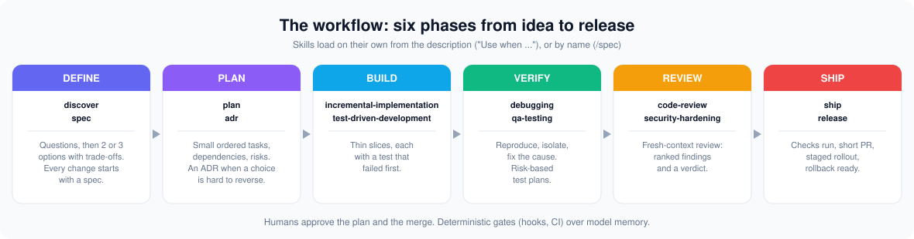
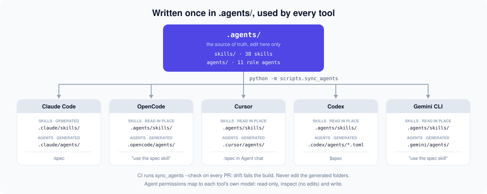
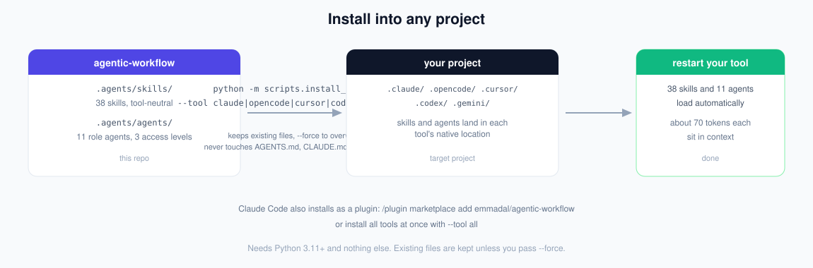

# agentic-workflow

**Skills and role agents that make AI coding agents work like a senior engineer: spec first, small slices, tests as the signal, independent review.**

39 skills and 11 agents, written once in `.agents/` and generated for Claude Code, OpenCode, Cursor, Codex and Gemini CLI. Built to be cheap: about 70 tokens per skill sit in context, and one skill costs about 380 tokens when it loads.

<p align="center">
  
</p>

## How it works

<p align="center">
  
</p>

You write skills and agents once in `.agents/`. A generator (`sync_agents`) renders the agents into each tool's own folder and the skills into `.claude/skills/`; OpenCode, Cursor, Codex and Gemini CLI read `.agents/skills/` directly. CI fails if a generated folder drifts. Agent permissions are mapped to each tool's own permission model: `read-only` (no shell, no edits), `inspect` (shell, no edits) and `write` (everything).

## Install

<p align="center">
  
</p>

### Claude Code

Plugin (recommended):

```
/plugin marketplace add emmadal/agentic-workflow
/plugin install agentic-workflow@agentic-workflow
```

Skills appear namespaced, for example `/agentic-workflow:spec`. To try it from a clone: `claude --plugin-dir /path/to/agentic-workflow`.

### Any tool, from a clone

`install_skills` copies the skills and agents into another project. It works for Claude Code too, if you prefer plain files to a plugin:

```bash
git clone https://github.com/emmadal/agentic-workflow && cd agentic-workflow
python -m scripts.install_skills /path/to/your/project --tool claude    # Claude Code (default)
python -m scripts.install_skills /path/to/your/project --tool opencode  # OpenCode
python -m scripts.install_skills /path/to/your/project --tool codex     # Codex
python -m scripts.install_skills /path/to/your/project --tool gemini    # Gemini CLI
python -m scripts.install_skills /path/to/your/project --tool cursor    # Cursor
python -m scripts.install_skills /path/to/your/project --tool all       # every tool at once
```

Add `--dry-run` to any of these to preview the copy without writing.

Needs Python 3.11+ and nothing else. Without `--tool`, it installs for Claude Code. Existing files are kept unless you pass `--force`. Your `AGENTS.md`, `CLAUDE.md` and settings are never touched.

### What each tool reads

| Tool | Skills read from | Agents read from | `install_skills` writes |
|------|------------------|------------------|-------------------------|
| Claude Code | `.claude/skills/` | `.claude/agents/` | `.claude/skills/` + `.claude/agents/` |
| OpenCode | `.agents/skills/` | `.opencode/agents/` | `.agents/skills/` + `.opencode/agents/` |
| Cursor | `.agents/skills/` | `.cursor/agents/` | `.agents/skills/` + `.cursor/agents/` |
| Codex | `.agents/skills/` | `.codex/agents/*.toml` | `.agents/skills/` + `.codex/agents/` |
| Gemini CLI | `.agents/skills/` | `.gemini/agents/` | `.agents/skills/` + `.gemini/agents/` |

### Verify the install

After installing, restart the tool and check:

```bash
claude -p "list project skills"              # Claude Code: all 39 skills load
opencode debug agents                        # OpenCode: all 11 agents listed
npx skills add . --list                      # vercel-labs skills CLI: lists project skills
```

## Load skills and agents

Skills load automatically when the task matches their description ("Use when ..."). To invoke one explicitly, or to use an agent:

| Tool | Invoke a skill | Use an agent |
|------|----------------|--------------|
| Claude Code | `/spec`, `/swift-ios`, or ask naturally | "have the reviewer agent audit this diff" |
| OpenCode | "use the spec skill" (its `skill` tool) | "ask the planner agent to break this down" |
| Cursor | `/spec` in Agent chat | "ask the planner agent to break this down" |
| Codex | `$spec`, or `/skills` to list them | "have the reviewer agent audit this diff" |
| Gemini CLI | "use the spec skill" (its `activate_skill`) | "ask the planner agent to break this down" |

You do not need to memorize anything: the model routes to the right skill from its description.

## Use the skills

| You are doing | Skill | What you get |
|---------------|-------|--------------|
| Unsure what to build | `discover` | Questions, then 2 or 3 options with trade-offs |
| Starting a change | `spec` | Goals, non-goals, testable acceptance criteria |
| Splitting the work | `plan` | Small ordered tasks, dependencies, risks |
| Building | `incremental-implementation` + `test-driven-development` | Thin slices, each with a test that failed first |
| Something broke | `debugging` | Reproduce, isolate, fix the cause |
| Before merge | `code-review` | Ranked findings and a verdict |
| Opening the PR | `ship` | Checks run, independent review, short PR. Never merges |
| Going live | `release` | Checklist, staged rollout, rollback |
| Pausing or resuming | `context-save` / `context-restore` | Checkpoint to `.context/checkpoints/`, then resume exactly |

### Session continuity

- `context-save` writes a checkpoint (goal, decisions, done, remaining work, git state) to `.context/checkpoints/<time>-<title>.md`. The folder is excluded from git.
- `context-restore` loads the newest checkpoint, compares branch and commits with the repo, reports drift and proposes the next step. It waits for your go-ahead before editing.

Checkpoints are local notes. Never put secrets in them.

### Personal skills

- `accountability`: turns goals into commitments with a date and a proof, keeps a ledger in `.context/accountability.md`, runs check-ins and weekly reviews, and does not accept "almost".
- `secretary`: meeting minutes with owners and dates, email and message drafts, day and week plans, briefs. Drafts only; it never sends or books anything.
- `swe-interview`: mock coding, system design and behavioral interviews with one question per turn and up to 3 hints, rubric scoring from 1 to 4, and drills aimed at your lowest scores.

## The 11 agents

Writer and reviewer are always different agents. No sub-agents in your tool? The skills tell the model to follow the same rules inline.

| Agent | Access | Use for |
|-------|--------|---------|
| `planner`, `explorer`, `architect` | read-only | Task breakdown, code search, design options and ADRs |
| `reviewer`, `security-auditor` | inspect (no edits) | Fresh-context diff review, vulnerability audit |
| `implementer`, `backend-engineer`, `frontend-engineer`, `mobile-engineer` | write | One planned task, test-first |
| `test-engineer`, `qa-engineer` | write | Tests, regression, release readiness |

The `access` level is mapped to each tool's permission model: `read-only` disables shell and edits, `inspect` keeps the shell but denies edits, `write` allows everything. Codex agents inherit the parent's sandbox and approvals; read-only agents there disable the shell tool.

## All 39 skills

- **Define and plan:** `discover` `spec` `plan` `adr` `context-engineering`
- **Build:** `incremental-implementation` `test-driven-development` `source-verified-coding` `code-simplification` `migration` `git-workflow`
- **Backend and platform:** `backend-engineering` `api-design` `security-hardening` `observability` `performance-optimization` `ci-cd`
- **Frontend:** `frontend-engineering` `nextjs-app-router` `browser-testing`
- **Mobile:** `mobile-engineering` `swift-ios` `kotlin-android` `android-compose` `kotlin-multiplatform` `react-native` `expo` `mobile-device-testing`
- **Quality and delivery:** `qa-testing` `test-plan` `debugging` `code-review` `ship` `release`
- **Session continuity:** `context-save` `context-restore`
- **Personal:** `accountability` `secretary` `swe-interview`

## Why it is cheap and precise

- **Descriptions are triggers**, one line, 280 characters or less, so the model routes correctly without reading bodies.
- **Bodies are 400 words or less.** Depth lives in `references/` and is opened only when needed.
- **Always-on text is small:** all descriptions plus `AGENTS.md` come to about 2,800 tokens for 39 skills.
- **Routing is tested** on every PR: 119 prompts, 97.5% right at rank 1, 100% in the top 3, 39 of 39 negative prompts routed away.
- **Behavior is measured:** in a 90-run headless test, perfect runs were 26/30 with these skills, 7/30 with no skill and 14/30 with the closest upstream skills, at about 40% lower cost per run than upstream. Method and limits are in [`docs/benchmarks.md`](docs/benchmarks.md).

## Develop this repo

```bash
python -m venv .venv && source .venv/bin/activate
pip install -e ".[dev]"
pytest -q --cov=agent --cov=scripts --cov-fail-under=80
ruff check . && ruff format --check .
```

`.agents/skills/` and `.agents/agents/` are the only source of truth. After editing them:

```bash
python -m scripts.validate_skills        # lint skills and agents
python -m scripts.sync_agents            # regenerate .claude, .opencode, .codex, .cursor, .gemini
python -m scripts.route_eval --min-rank1 95
python -m scripts.token_report           # token cost of the catalog
```

Never edit the generated folders. CI runs `sync_agents --check` and fails on drift. Adding a skill also needs routing cases in `evals/routing.json`. The authoring rules are in [`docs/compatibility.md`](docs/compatibility.md).

## Contributing

Every skill and agent is written once in `.agents/` and generated for all tools. To add or change one:

1. **Fork and clone** the repo, then set up the environment as in [Develop this repo](#develop-this-repo).

2. **Edit the source of truth only**: `.agents/skills/<name>/SKILL.md` (plus optional `references/`) or `.agents/agents/<name>.md`. Never edit the generated folders (`.claude/`, `.opencode/`, `.codex/`, `.cursor/`, `.gemini/`); CI fails on drift.

3. **Follow the authoring rules** (enforced by `python -m scripts.validate_skills`):

   - Skill folder name equals frontmatter `name` (lowercase, hyphens).
   - Description is one line, 280 characters or less, starts with "Use when ...". It is the routing trigger.
   - Body at most 400 words; depth goes in `references/` opened on demand.
   - Agents have `name`, `description` and `access`: `read-only`, `inspect` or `write`.
   - Skill bodies are tool-neutral: "delegate to the `reviewer` agent, or follow its rules inline if sub-agents are unavailable".

4. **Add routing cases** for a new skill in `evals/routing.json`: at least 3 positive prompts and 1 negative prompt owned by another skill. Then check:

   ```bash
   python -m scripts.route_eval --min-rank1 95
   python -m scripts.token_report
   ```

5. **Run the gates** before pushing:

   ```bash
   python -m scripts.validate_skills
   python -m scripts.sync_agents
   pytest -q --cov=agent --cov=scripts --cov-fail-under=80
   ruff check . && ruff format --check .
   ```

6. **Open a short PR**: conventional commits, Summary / Changes / Testing. A reviewer must approve; CI runs lint, `validate_skills`, `sync_agents --check`, the routing eval, the token report, the tests, `pip-audit` and `bandit` on every PR.

No secrets in code, logs or prompts, and no force-pushes.

## Limits

- Verified by running: Claude Code (all 39 skills load, also through `install_skills` and as a plugin) and OpenCode (`opencode debug agents` lists the 11 installed agents, and with an empty `HOME` the skill tool it sends to a mock model provider lists exactly all 39 skills installed in `.agents/skills/`, none missing, plus two OpenCode built-ins). `npx skills add . --list` run in this repo discovered and listed the project skills (the end of the list was seen, from `swift-ios` to `test-plan`; each of the 39 was not confirmed individually). Cursor, Codex and Gemini CLI are not installed here, so their loading was not run; their paths follow each tool's documentation. Details in [`docs/compatibility.md`](docs/compatibility.md).
- `accountability`, `secretary` and `swe-interview` have a small single-turn behavioral test (5 runs per cell) and a two-turn test (5 reps); longer multi-turn behavior is untested. See [`docs/benchmarks.md`](docs/benchmarks.md).
- Hooks in `.claude/settings.json` are Claude Code only; CI applies the same gates to every tool.
- Model pinning applies to Claude Code and OpenCode only.
- The repo is public but has no license file yet, so no reuse rights are granted until one is added.

## Project structure

```
.agents/skills/, .agents/agents/     source of truth
assets/                              README diagrams (SVG)
.claude/ .opencode/ .codex/ .cursor/ .gemini/   generated, do not edit
.claude-plugin/                      Claude Code plugin and marketplace manifests
scripts/                             sync_agents, validate_skills, install_skills, route_eval, token_report
evals/                               routing cases (CI) and behavioral evals
agent/, tests/                       small Python agent loop (optional) and tests
docs/                                workflow, sdlc, engineering-standards, compatibility, benchmarks, adr/
AGENTS.md, CLAUDE.md                 shared rules; CLAUDE.md imports AGENTS.md
```

### Optional agent loop

`agent/` is a minimal tool-using loop on the Anthropic SDK with step and token budgets. It does not load the skills above.

```bash
export ANTHROPIC_API_KEY=...
python -m agent.cli "explain the repo layout" --workdir .
# write_file and run_tests execute code; enable only in a sandbox
python -m agent.cli "add a --verbose flag" --workdir . --allow-write
```

## Principles

1. Spec before code.
2. Small, verifiable slices.
3. Tests are the feedback signal.
4. Writer and reviewer are separate agents.
5. Least privilege per role.
6. Deterministic gates (hooks, CI) over model memory.
7. Budgets and stop conditions on every loop.
8. Humans approve the plan and the merge.
